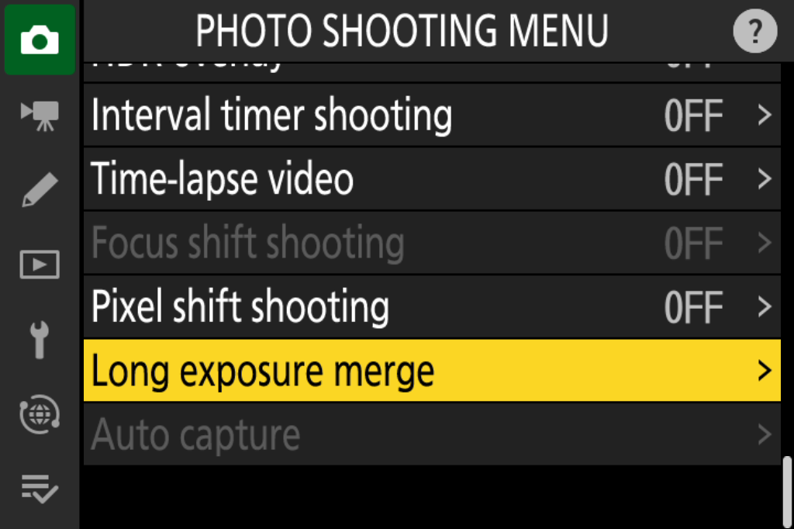
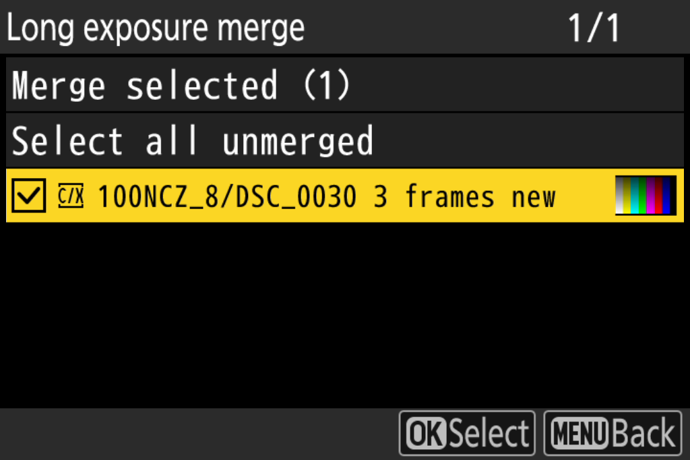
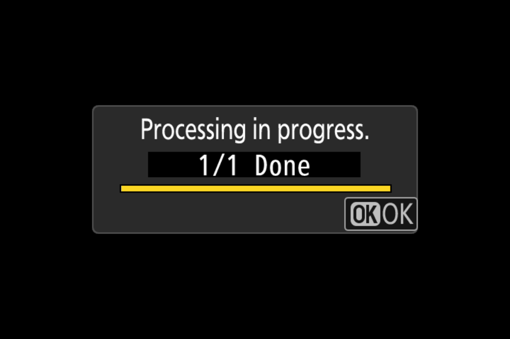

# Long exposure merge (experimental, not camera-tested)

`longexposure.py` builds a Z8 firmware with a **Long exposure merge** row in the photo shooting menu. It averages a
series of ordinary NEFs already on the cards into one new NEF, which gives the look of a long exposure (smooth water,
streaked clouds, removed passers-by, less noise) from a burst or an interval series shot at normal shutter speeds,
without an ND filter.

**Status:** host- and emulator-tested only (an end-to-end merge in the emulator produced an exact average). It has never run on a camera. The author of this build does not plan to
flash it either. If you do, you do it at your own risk (see [LICENSE](../LICENSE) and [NOTICE](../NOTICE.md)).

It is standalone, like `bankmode.py`: it takes the place of the toolkit's pixel-shift merge (it reuses its menu row,
browser, progress page and card access) and does not combine with `bankmode.py` or the toolkit's features.

## Shooting

1. Image area FX, image size L, NEF (RAW), 14-bit, lossless compressed. HE/HE★, DX and other sizes are refused.
2. Manual exposure (or at least fixed exposure, ISO and aperture). The series must keep the same shutter speed,
   aperture, ISO and exposure compensation, the same image area and the same black level. White balance may change
   (auto WB is fine): the output keeps the first frame's WB.
3. Shoot the series on a tripod: continuous release (C15, C30 ...) or interval timer shooting. Frames must be
   consecutive (shutter count +1 each), in the same folder of the same card, at most 120 s apart, 2 to 256 frames.
   A series ends at the first frame that breaks one of these rules.

The total "exposure" is the sum of the frame times: 30 frames of 1/2 s ≈ 15 s, 120 frames of 1 s at C15 ≈ 2 min.
The gaps between frames show as small breaks in very fast moving lights; for water, clouds and crowds they do not.

## Merging

Photo shooting menu › **Long exposure merge**. The camera scans both cards and lists the series found (first file,
frame count, new / merged). OK selects a series, *Select all unmerged* selects all of them, *Merge selected* starts.
MENU cancels a running merge. The result is `DSC_xxxx_AVG.NEF` beside the first frame (`_AVG_2`, `_AVG_3` ... if the
name exists). Existing files are never changed. `LEXPAVG.LOG` on card A records each run.

The output is a standard Z8 NEF: frame 1's file with the raw image replaced by the rounded mean of all frames,
re-encoded with the camera's lossless code. Everything else (EXIF, maker notes, embedded JPEG preview) is frame 1's,
so the camera preview and the EXIF shutter speed are those of frame 1. Raw converters show the averaged image.

## How it works

| Step | Detail |
|---|---|
| Scan | Both cards, every `DCIM` folder (up to 8192 NEFs). Each NEF is probed: shutter count (maker note 0xA7), serial, DateTimeOriginal, black level, crop, dimensions, exposure. Pixel-shift and other special frames are skipped. |
| Group | Sorted by name; a frame joins the current series when it is the next shutter count, same serial and same signature (black, crop, dimensions, exposure), and at most 120 s later. Series of one frame are dropped. |
| Average | In bands of 256 rows (smaller if memory is short): each frame is opened, its decoder continues through the band's rows into a 32-bit sum, and the file is closed. Memory and open files stay constant whatever the number of frames. |
| Encode | The band's mean `(sum + n/2) / n` goes through `lexp_enc.c`, the exact inverse of the toolkit's decoder (prefix code, the two-row predictors, seeds from the 0x96 block). |
| Write | Frame 1's bytes up to the strip, the new strip padded to 16 bytes, then the strip byte count patched. Written to `LEXP_TMP.TMP`, renamed when complete. |

Code: `z8longexp/src` (the pixel-shift unit's sources with `group.c`, `job.c` changed and `lexp_enc.c`,
`lexp_job.c` added). The unit is compiled with clang at build time and linked into the pixel-shift code cave
(0x40990000–0x409D8000, about 104 KB).

## What the toolkit shows about larger changes

Studying the upstream features was the starting point:

- **Open gate / N-RAW** (`z8opengate`) is done with assembly hooks (`src/*_hooks.S`) placed into the stock recording
  path: branch-outs at chosen instructions that change sensor readout and record sizes, then return to stock code.
  It works because the stock pipeline already supports the formats; the hooks only change parameters.
- **Pixel-shift merge** (`z8pixelshift`) is a compiled C program in a code cave. The patcher adds a menu row, string
  table entries in all 36 languages (checked against the glyphs in the stock font), a browser page, a progress page and
  OK / MENU handling, and the program calls the firmware's own file, heap, task and UI functions at fixed addresses.
  It works on files after capture, so it never touches the sensor or the image pipeline.

A true in-camera long exposure (adding frames while shooting) would need the first approach on the image pipeline
itself, whose DMA and processing blocks are not documented and cannot be checked in the emulator. The stock Multiple
exposure (*Average* mode) does stack during capture but is limited to 10 frames, and raising that limit did not work
(see `docs/menu-bank.md`). So this build takes the second approach: post-capture, file to file, built on the
pixel-shift unit's proven card access and UI.

## Build

```sh
python longexposure.py "/path/to/Z_8_0311.bin" --version 04.20 --tag e0 --output build/longexp
```

Needs clang (aarch64 target) and capstone, like the toolkit. Expected `Z_8_0420.bin` SHA-256 with clang 18.1.3:
`12f2c2f0b17965c8e8c7052612919e8cb08b189b20d554926e40ce92d0472623` (another compiler version gives another hash).

## Tests

- Encoder: decoding a real firmware-written NEF and re-encoding it gives the original strip byte for byte.
- Host job (`tests/longexp`): series detection (including a lone frame and a pair 200 s apart, both refused), outputs
  equal to the rounded mean of the inputs (0 differing samples), a second run finding nothing new, small-memory bands,
  a 40-frame series.
- Emulator: end-to-end merge on a virtual card, see below.

### Emulator test

Run in the z8-qemu emulator (firmware above, unmodified) with a virtual exFAT card holding three test frames
(`DSC_0030..0032.NEF`, made from an emulator-written NEF with noise added, consecutive shutter counts, 10 s apart):

1. The row appears in the photo shooting menu; the scan lists `100NCZ_8/DSC_0030 3 frames new` (card B absent).
2. Select the series, *Merge selected (1)*, *Merge 1 selected series*: the progress page ends with "1/1 Done".
3. The card then holds `DSC_0030_AVG.NEF` (55.8 MB) and `LEXPAVG.LOG` (`job status 0 merged 1/1`). Decoded on the
   host, the output equals the rounded mean of the three inputs: **0 differing samples** out of 45.7 million.

| Menu row | Series found | Merge finished |
|---|---|---|
|  |  |  |

The emulator's timings say nothing about the camera's speed.

## Limits

- Not tested on a camera: speed, memory available while the camera is in use, and behaviour with real cards are
  unknown. Expect several seconds per frame.
- Output is limited by the card: each `_AVG.NEF` is about the size of one frame.
- Hot pixels and noise average down; moving lights become streaks with small gaps.
- Thumbnails in the browser show the first frame only; camera playback shows the first frame's preview.
