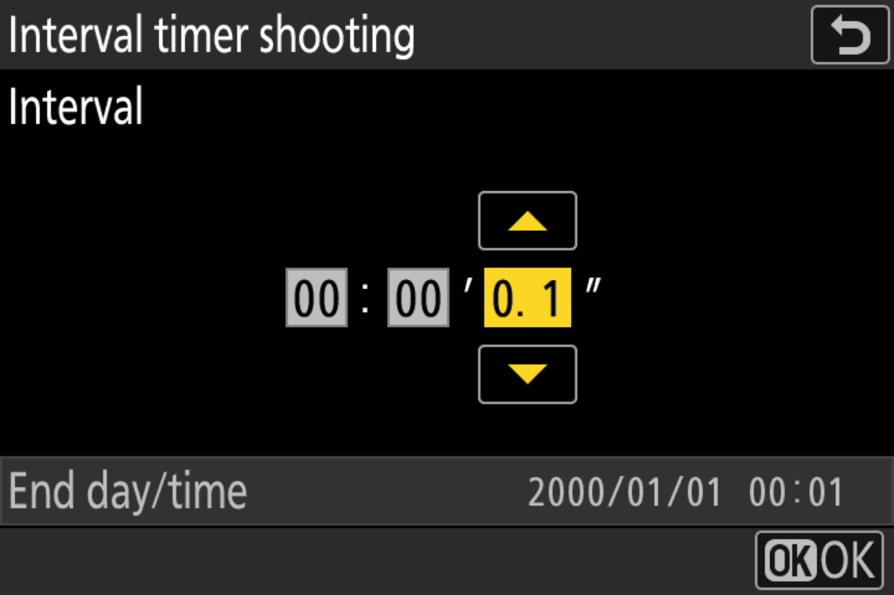
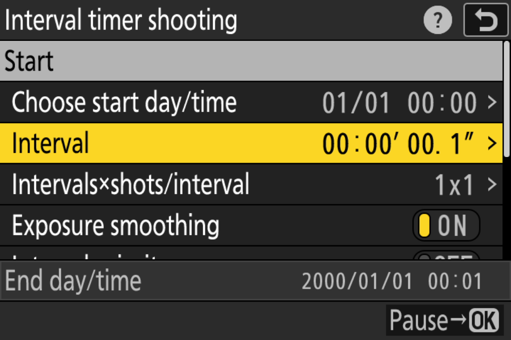

# Z8 menu-bank, focus shift and framing additions (`bankmode.py`)

This fork adds a separate build script, `bankmode.py`, which patches the official **Nikon Z8 C 3.11** firmware with a set of menu and shooting changes. It is **standalone**: it does not combine with the toolkit's four features (`prores`, `precapture`, `pixelshift`, `opengate-nraw`), because they share menu rows, a menu state and the free text area with each other and with this patch.

**Experimental firmware.** Same warning as the main toolkit: building or installing can cause data loss, card corruption or camera malfunction, and offline checks do not guarantee camera safety. Flash at your own risk. See [LICENSE](../LICENSE) and [NOTICE](../NOTICE.md).

## What it changes

Menu banks
- **Menu bank behavior** row at the end of the Setup menu: choose whether switching shooting menu banks auto-stores the current settings into the bank being left, a "save to bank" command, and **linking** the photo shooting menu bank and the Custom Settings bank so they switch together.
- **Release mode is stored per menu bank**, through the camera's real setting items.
- After a linked switch, both bank changes are announced (fixes a mismatch between the rear and top displays seen on the camera).
- **Bracketing burst button**: while held, bracketing is switched on.

Focus shift shooting
- **End point**: set the current focus position as the end of the series (Focus end point sub-page: Set / Clear). The camera then estimates the number of frames needed to reach it, shown on the focus shift page and on the focus step width slider. The end point is forgotten when the camera goes to standby.
- The focus shift page shows the end point distance and the **current focus distance** (corrected distance scale; estimate up to the lens's infinity position when no end point is set).
- **i menu start**: selecting the *Focus shift shooting* item in the i menu starts the series directly from live view.

Interval timer (e0, not camera-tested)
- **Intervals below 1 s**: Photo shooting menu › Interval timer shooting › Interval accepts **00:00'00"** (shoot as fast as the camera allows) and **0.1 s to 0.9 s** in 0.1 s steps (stock: 1 s minimum, plus a 0.5 s step hidden in the firmware). Set hours and minutes to 00, then go below 01 in the seconds column; the row shows 00:00'00.N". See [Interval timer below 1 s](#interval-timer-below-1-s-e0).

Framing grid
- **Custom frame**: Custom Settings > Grid type (photo) gets a sixth entry. Its page sets a **crop factor** from 1.00x to 1.50x (0.05 steps) and an **aspect ratio X:Y** (1–99 each; default 1.00x 3:2 = the whole frame). Live view draws the largest X:Y rectangle centred in the crop area. OK starts / ends editing a value, up / down / the dials change it, back stores it.

## Status

- Firmware built from this branch has been **flashed successfully onto a Nikon Z8**.
- The menu-bank changes were used on a camera during development (a link defect found there was fixed).
- The focus shift additions (end point, frame estimate, current focus distance, i-menu start) and the Custom frame grid have been **tested on the camera and work**. They were also checked offline (independent verifier, instruction-level harness, menus in a QEMU emulator).
- **e0 interval timer below 1 s: not tested on a camera.** Checked offline only: verifier, an instruction-level harness of the changed firmware routines, and the Interval page in the emulator (0.0 / 0.1 / 0.2 s steps, OK stores 0.1 s and 0 s, the page reopens on the stored 0.1 s, 01:00'00" still shows the stock form). The emulator cannot run a real interval series (its clock is not set).
- A test raising Multiple exposure above 10 shots froze the camera ("busy") and was reverted; it is not in the current build.

## Build and verify

Requirements: Python 3.10+, `requirements.txt` (Capstone), and `llvm-objdump` for the verifier.

```sh
python bankmode.py "/path/to/Z_8_0311.bin" --version 04.20 --tag e0 --output build/bank
python verify_bankmode.py "/path/to/Z_8_0311.bin" build/bank/Z_8_0420.bin --version 04.20 --tag e0
```

With version 04.20 and tag e0 the output should be `Z_8_0420.bin` with SHA-256 `8ae3523b48b983e1defda5eb7f7a06e197035a0d363d88cafbf6ff1c41370c1b` (the d0 build, without the interval change, was `b8323e3f71ec6c865a9bb64b4440567b9c6a968f00582ae590f4cdf802b20f7a`). Tags are a lowercase letter plus a digit. Build from the official input each time; the output directory must not exist.

Developer harness (runs the patch code under QEMU against stubs; needs clang, ld.lld and qemu-system-aarch64):

```sh
python tests/bankmode_harness/run_harness.py --qemu /path/to/qemu-system-aarch64
python tests/bankmode_harness/run_harness.py --qemu /path/to/qemu-system-aarch64 --mutate <name>   # each mutation must fail
python tests/interval_harness/run.py build/bank/Z_8_0420.bin --qemu /path/to/qemu-system-aarch64     # e0 interval timer
python tests/interval_harness/run.py /path/to/Z_8_0311.bin --stock --qemu /path/to/qemu-system-aarch64  # must detect stock
```

No Nikon firmware, patched firmware or extracted firmware data is included in this repository; obtain the official input from Nikon yourself.

## Interval timer below 1 s (e0)

**Not tested on a camera.** What the stock firmware does, and what e0 changes:

| | Stock C 3.11 | e0 |
|---|---|---|
| Interval page (seconds column, kept in tenths of a second) | below 1 s, with hours and minutes at 0, the column steps by 0.5 s | steps by 0.1 s: 0.0, 0.1 … 0.9, 1, 2 … |
| OK on the page | stores hours, minutes, seconds and milliseconds (four setting items), milliseconds = 500 only for exactly 0.5 s; refuses 00:00'00" | milliseconds = tenths × 100 − seconds × 1000 (100 … 900); accepts 0 |
| Start | refuses a zero interval (error 0xB) | accepts it |
| A shot the camera is late for (busy with the previous one) | the interval is skipped and counts as taken | below 1 s: taken as soon as the camera is ready; 1 s and longer: stock |
| A due shot whose readiness check fails | skipped | below 1 s: waits and retries; 1 s and longer: stock |
| Time to the next shot (0x40FCAD00) | loops "next += interval" until it is in the future: never ends with 0 | returns max(next − now, 0) for a zero interval |
| Interval row | 00:00'00.5" for 0.5 s only | 00:00'00.N" below 1 s |

With 00:00'00" the camera starts the next interval as soon as the previous one is done, so the real rate is set by the shutter speed, the release (mechanical / electronic), image processing and the card. Without the late-shot change, a sub-second interval would mostly skip intervals (each skipped interval uses up one of the "number of intervals"), and a zero interval would end the series after the first interval or hang in the time-to-next loop.

| Interval page at 0.1 s | Interval timer shooting page |
|---|---|
|  |  |

Notes
- Other screens that show the interval (for example the remaining-time display while shooting) use whole seconds and show 00:00'00" below 1 s.
- The no-skip rule applies to every interval below 1 s, including the stock 0.5 s. It also applies to time-lapse video if its interval is below 1 s (the time-lapse page itself is unchanged).
- "Interval priority" still checks the interval against the exposure and refuses settings it cannot keep.

Firmware sites (all in 3.11 addresses): page step 0x405EB7F8, OK handler 0x405EBB14 / 0x405EBB28 / 0x405EBB34, Interval row text 0x405F5008..0x405F5024 (sub-second form only with hours and minutes at 0), start check 0x40FB2220, shot timing 0x40FBDEFC and 0x40FBDF5C, time to next shot 0x40FCAD3C (guard code after the Custom frame code in the GUI area). The harness `tests/interval_harness` runs the changed routines from the built image under QEMU with stubs for what they call (25 checks); run against the official image it detects the stock behaviour, including the endless loop.

## With the toolkit's RAW pre-capture (f1, toolkit v0.4.0)

`bankmode.py --precapture` adds the RAW pre-capture of NikonFirmwarePatch **v0.4.0** (C15/C30 history and post-release frames follow ordinary Image quality, HE/HE★ RAW, FX and, new in v0.4.0, DX; lossless selections give HE★; description and known issues in the v0.4.0 [RAW/pre-capture guide](https://github.com/XinmiaoZhao/NikonFirmwarePatch/blob/v0.4.0/docs/raw-precapture.md)). In v0.4.0 pre-capture is part of the `photo-tools` group together with pixel shift; only the pre-capture part is taken. Build f1 = e0 + pre-capture v0.4.0 (the earlier f0 used v0.3.0 and is withdrawn).

- **Same code and edits as the toolkit.** The machine code is the reviewed v0.4.0 `resources/precapture.bin` (Release toolkit ZIP only, SHA-256 `6dc74ff5…44654`), copied to `resources/precapture-v0.4.0.bin`. `z8precapture_v040/` is the v0.4.0 adapter and source (hashes checked against the v0.4.0 `compiled.json`); `resources/precapture-v0.4.0.json` holds the 42 reviewed pre-capture rows of the v0.4.0 `photo-tools` recipe and the code's symbols. The generated edits must equal those rows, or the build stops.
- **No shared bytes.** None of the 42 pre-capture windows touches a byte this patch changes (v0.4.0 adds one hook to v0.3.0's: the HSFC image-area normaliser 0x41059C60, for DX). The text-copy boundary is computed once and covers both (pre-capture code 0x409F0000..0x409F847D, below this patch's code page 0x40A00000).
- **Checks.** `verify_bankmode.py --precapture` runs every menu-bank check and accepts only the reviewed pre-capture windows (old and new SHA-256 each); without the flag the file is rejected. Byte comparison: f1 equals e0 outside the pre-capture windows and equals the v0.4.0 toolkit's own `photo-tools` build (which its `verify.py` passes) inside them. The build boots in the emulator.
- **Not camera-tested as a combination.** Both touch the release path in different places (pre-capture: C15/C30 capture, image-area mode and NEF writing; this patch: release mode per bank, bracketing burst hold, focus shift and interval timing).

With version 04.20 and tag f1 the output is `Z_8_0420.bin`, SHA-256 `fd6c9d2be4691b70b3c9ff99149e4e5f73f556d6a5c96ba281d0fff2111963b5`.

The toolkit's ProRes feature cannot be combined: it uses the same menu state (0x102) and code page as this patch's sub-page. Pixel shift (v0.4.0 photo-tools) and open gate / N-RAW share only the string tables and could be added later.
